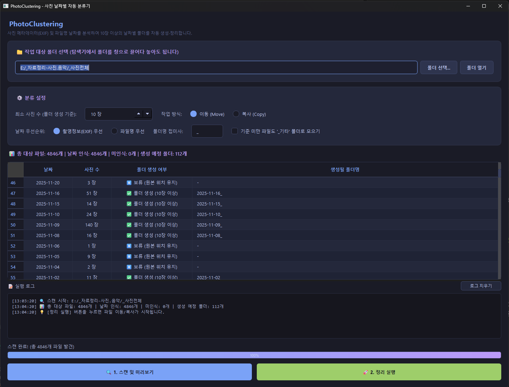

# 📷 PhotoClustering (사진 날짜별 자동 분류 및 정리기)

스마트폰, 카메라, 다운로드 폴더에 마구 흩어져 있는 대량의 사진 및 동영상 파일들을 **EXIF 메타데이터와 파일명 날짜 패턴을 정밀 분석하여 날짜별 폴더(`YYYY-MM-DD_`)로 깔끔하게 자동 분류·정리**해 주는 PySide6 기반 데스크톱 애플리케이션입니다.

---

## 🖥️ 프로그램 실행 화면

<p align="center">
  
</p>

---

## 🌟 주요 기능

1. **🔍 3단계 정밀 날짜 추출 엔진 (`core/date_extractor.py`)**
   * **1순위 (EXIF 메타데이터)**: 스마트폰/디지털카메라가 촬영 시 기록한 원본 일시(`DateTimeOriginal`, `DateTimeDigitized`) 우선 추출
   * **2순위 (파일명 정규식 분석)**: 메타데이터가 손실된 카카오톡 사진, 스크린샷 등의 파일명 속 날짜 패턴(`20240101`, `2024-01-01`, `2024_01_01`, `2024.01.01`) 자동 파싱
   * **3순위 (파일 수정일시 Fallback)**: 옵션 활성화 시 파일의 시스템 수정시간(mtime) 활용 가능

2. **🎯 스마트 클러스터링 (폴더 난립 방지)**
   * 사진이 1~2장뿐인 날짜까지 무분별하게 폴더가 생기지 않도록, **"N장(기본 10장) 이상 모인 날짜만 폴더를 생성"**하는 임계값(Threshold) 조절 기능 제공

3. **🛡️ 완벽한 데이터 유실 방지 (중복 회피)**
   * 이동할 대상 폴더에 이미 동일한 이름의 파일이 존재할 경우, 파일을 덮어쓰지 않고 `파일명_1.jpg`, `파일명_2.jpg`로 **자동 넘버링 부여**
   * 원본을 유지하는 **복사(Copy) 모드**와 디스크 용량을 아끼는 **이동(Move) 모드** 선택 지원

4. **📁 광범위한 미디어 포맷 지원**
   * **이미지**: `.jpg`, `.jpeg`, `.png`, `.webp`, `.bmp`, `.gif`, `.tiff`, `.heic`
   * **동영상**: `.mp4`, `.mov`, `.avi`, `.mkv`, `.wmv`

5. **🖥️ 사용자 친화적 모던 GUI (`ui/`)**
   * **폴더 드래그 앤 드롭**: 탐색기에서 작업할 폴더를 창으로 끌어다 놓기만 하면 즉시 인식
   * **사전 시뮬레이션(미리보기)**: 실제 파일을 옮기기 전 날짜별 파일 개수와 생성될 폴더명을 테이블로 사전 검토
   * **UI 멈춤 방지 비동기 처리**: 대량(수천~수만 장) 미디어 작업 시에도 창이 굳지 않도록 `QThread` 기반 백그라운드 워커와 실시간 프로그레스바/로그 창 제공

---

## 🚀 실행 및 빌드 방법

### 1. 개발 및 일상 실행
```bash
# 의존성 패키지 설치
pip install -r requirements.txt

# 프로그램 실행 (또는 run.bat 더블 클릭)
python main.py
```

### 2. 단위 테스트 실행 (UnitTest)
핵심 날짜 추출 및 파일 정리 엔진의 무결성을 검증합니다:
```bash
python test_photoclustering.py
```

### 3. 독립 실행 파일 (.exe) 빌드
**`build_exe.bat`** 파일을 실행하면 PyInstaller를 통해 독립 실행 프로그램이 생성됩니다:
* 빌드 완료 위치: `dist/PhotoClustering.exe` (단일 실행 파일)
* **배포 권장**: 소스 코드에는 포함하지 않고, GitHub 저장소의 **Releases** 탭에 업로드하여 배포합니다.

---

## 📁 프로젝트 구조

```text
photo-clustering/
├── main.py                  # 프로그램 진입점 (DPI 스케일링 및 GUI 실행)
├── requirements.txt         # 의존성 라이브러리 (PySide6, pillow)
├── test_photoclustering.py  # 날짜 추출 및 정리 로직 단위 테스트
├── run.bat                  # 가상환경 자동 감지 즉시 실행 배치 파일
├── build_exe.bat            # 단일 .exe 빌드 자동화 스크립트
├── .gitignore               # 깃허브 업로드 제외 설정
├── README.md                # 프로젝트 안내 문서
├── TODO.local.md            # 로컬 작업 체크리스트 (깃허브 제외)
│
├── core/                    # [비즈니스 로직 레이어]
│   ├── __init__.py
│   ├── date_extractor.py    # EXIF 및 정규식 날짜 파싱 엔진
│   └── organizer.py         # 스캔, 클러스터링, 중복 회피 및 파일 이동
│
└── ui/                      # [프레젠테이션 레이어]
    ├── __init__.py
    ├── main_window.py       # 메인 윈도우 UI 및 테이블 뷰
    ├── worker.py            # QThread 비동기 백그라운드 워커
    └── style.py             # 모던 다크 테마 QSS 스타일시트
```

---

## 📋 시스템 요구사항
* Python >= 3.10
* PySide6 >= 6.6.0
* Pillow >= 10.0.0
